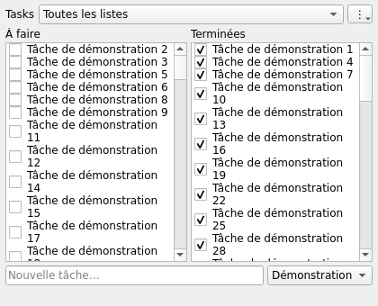

# Desktop Tasks

Widget Google Tasks natif, compact et open source pour **KDE Plasma** et **Windows 10 x64**. C++17 / Qt Widgets, sans Electron, WebView, navigateur embarqué ni serveur personnel.

**Première version expérimentale.** Les tests automatisés couvrent le protocole, le cache et les mutations simulées. La connexion Google réelle, l’intégration dans une session Plasma et Windows 10 interactif restent à valider. Ne pas confondre les tests Windows Server CI avec une validation Windows 10.



## Installer

Télécharger les fichiers de la [dernière release](https://github.com/alexalmny/desktop-tasks/releases) et vérifier `SHA256SUMS.txt`.

### KDE Plasma, Linux

Le `.deb` x64 cible **Ubuntu 24.04 / KDE neon basé sur 24.04**, Qt ≥6.4. Pour d’autres distributions ou ARM64, compiler avec leurs paquets natifs (ci-dessous).

```sh
sudo apt install ./desktop-tasks-*.deb
desktop-tasks
```

X11 : fenêtre EWMH de type bureau, visible sur tous les bureaux virtuels. Plasma Wayland : couche basse via layer-shell-qt. Ce n’est pas un Plasmoid : aucun plasmashell modifié ni extension à installer. Un mode fenêtre normal (`desktop-tasks --window`) reste disponible en cas de conflit avec le compositeur. Le paquet dépend de Qt/layer-shell/KWallet ou Secret Service déjà partagés avec le système, sans en embarquer une seconde copie.

### Windows 10 x64

Extraire **tout** `Desktop-Tasks-Windows-x64.zip` dans un dossier utilisateur, puis lancer `desktop-tasks.exe`. Ne pas déplacer l’EXE seul : les DLL et `platforms/` sont nécessaires. Si le runtime Microsoft manque, exécuter `vc_redist.x64.exe` inclus si présent, ou installer le [runtime Microsoft officiel x64](https://aka.ms/vs/17/release/vc_redist.x64.exe). Binaire non signé : SmartScreen peut afficher un avertissement.

L’intégration bureau utilise WorkerW d’Explorer, non documenté par Microsoft ; `desktop-tasks.exe --window` contourne les incompatibilités. Après un redémarrage d’Explorer, relancer le widget. Aucun administrateur requis. Windows 10 est la cible de compatibilité Qt, mais n’a pas été testé sur cette VM.

## Connecter Google

1. Créer un client OAuth Google **Application de bureau**, scope Google Tasks, selon le [guide OAuth](docs/OAUTH.md). Aucun client partagé ni identifiant personnel n’est publié.
2. Menu **⋮ → Importer le client OAuth…**, sélectionner le JSON téléchargé.
3. **Connecter Google…**, autoriser le compte dans le navigateur système. Le widget reçoit le retour uniquement sur `127.0.0.1`, port aléatoire, avec PKCE et contrôle `state`.

Un coffre système fonctionnel est obligatoire : **KWallet / Secret Service** sous Linux, **Windows Credential Manager** sous Windows. Pas de fichier de jetons en clair ni de synchronisation de jetons entre machines. Configurer séparément chaque ordinateur ; utiliser le même compte que l’application Google Tasks Android.

## Utiliser

- Deux colonnes **À faire | Terminées**. Cocher/décocher, touche Espace sur une tâche sélectionnée ou glisser vers l’autre colonne.
- Filtre en haut : toutes les listes ou une seule. Choisir la liste de destination à droite du champ de saisie ; **Entrée** ajoute une tâche.
- Un **•** signale une modification sauvegardée mais pas encore confirmée par Google.
- Synchronisation immédiate des actions, puis toutes les **120 s**, configurable entre 30 et 3600 s. Retour Android visible au prochain cycle. Cache lisible et modifications mises en attente hors ligne.
- **⋮ → Taille, position et options…** règle dimensions et coordonnées sur l’écran principal. Le mode bureau/fenêtre prend effet au redémarrage. Le widget ne déplace pas les tâches d’une liste à l’autre ; le glisser-déposer change leur statut.
- Le message en bas résume l’état ; son infobulle donne l’erreur complète.

Pour le démarrage automatique, ajouter la commande dans **Configuration système KDE → Démarrage automatique**, ou un raccourci Windows dans `shell:startup`. Aucun service permanent ni entrée système cachée.

### Erreurs et protection des données

Les réponses serveur ne remplacent le cache qu’après une lecture complète réussie. Les écritures sont atomiques et les actions mises en attente avant envoi. En cas d’échec disque, aucune mutation n’est envoyée. Un changement de statut ne touche ni titre, ni notes, ni échéance sur Google. Les modifications locales de statut en attente gagnent lors de leur envoi ; pas de fusion avancée de conflits.

Un ajout peut réussir sur Google alors que sa réponse est perdue. Dans ce cas (ou après un crash pendant l’ajout), il reste **incertain** et n’est **jamais renvoyé automatiquement**. Vérifier dans Google Tasks :
- s’il existe déjà, abandonner les modifications en attente via le menu puis synchroniser ; **attention : cette action abandonne toutes les modifications locales non confirmées** ;
- sinon, confirmer « Réessayer les ajouts incertains ». La confirmation avertit du risque de doublon.

Les erreurs 401/403 demandent parfois une reconnexion ou une correction du consentement ; un 404 signifie souvent une tâche/liste supprimée ou un mauvais compte. Les tâches assignées Workspace peuvent ne pas autoriser toutes les mutations. Les sous-tâches sont affichées à plat ; ni dates, ni notes, ni édition/suppression, ni ordre personnalisé dans cette version. `showHidden=true` inclut les tâches terminées masquées par Android.

## Données locales

- Linux : `${XDG_DATA_HOME:-~/.local/share}/desktop-tasks/`.
- Windows : `%LOCALAPPDATA%\desktop-tasks\`.
- Profils indépendants : `--profile /chemin/absolu` (un compte par profil).

`cache.json` : titres, listes, statuts, opérations en attente ; **non chiffré**, permissions utilisateur sous Linux, ACL du profil sous Windows. `oauth-client.json` : définition locale du client public desktop. `settings.ini` : options, aucun jeton. Le refresh token est dans le coffre système, associé au chemin absolu du profil. L’access token reste en mémoire. Ne pas déplacer un profil contenant une connexion sans se reconnecter. Pour révoquer l’accès : [autorisations du compte Google](https://myaccount.google.com/permissions), fermer le widget puis supprimer ses données et son entrée `desktop-tasks` dans le coffre. Un cache corrompu n’est jamais écrasé : en sauvegarder une copie avant récupération.

## Compiler et tester

Linux Ubuntu 24.04 :
```sh
sudo apt install cmake ninja-build g++ qt6-base-dev qtkeychain-qt6-dev \
  libxcb1-dev liblayershellqtinterface-dev qt6-wayland layer-shell-qt
cmake -S . -B build -G Ninja -DCMAKE_BUILD_TYPE=Release
cmake --build build --parallel 2
ctest --test-dir build --output-on-failure
python3 -m unittest discover -s tests -p 'test_*.py' -v
./build/desktop-tasks --demo --quit-after 5
(cd build && cpack -G DEB)
```

Ubuntu 22.04 : omettre layer-shell-qt (version Qt5 incompatible), compilation X11 avec Qt6.2 ; forcer `--window` sous Wayland. La CI 24.04 compile le chemin Qt6 Wayland.

Windows : Visual Studio 2022 C++, CMake ≥3.22 et Qt **6.8.3 MSVC2022 x64** :
```powershell
cmake -S . -B build -A x64 -DCMAKE_PREFIX_PATH=C:/Qt/6.8.3/msvc2022_64
cmake --build build --config Release --parallel 2
$env:PATH = "$pwd\build\bin\Release;C:\Qt\6.8.3\msvc2022_64\bin;$env:PATH"
ctest --test-dir build -C Release --output-on-failure
```
QtKeychain 0.15.0 est téléchargé à un commit/hash épinglé sous Windows ; Linux utilise le paquet de la distribution. Voir [architecture et étude](docs/DESIGN.md), [mesures et validation](docs/PERFORMANCE.md), [licences et sources correspondantes](THIRD_PARTY_NOTICES.md).

## CI et releases

Actions sur `main`, PR et tags `v*` : builds natifs Linux x64 / Windows Server 2022 x64, tests Qt, rendu GUI avec données fictives, mesures de processus, sanitizers Linux, paquet DEB et ZIP autonome Windows. Aucune connexion Google en CI, aucun secret de compte nécessaire. Un tag publie une **prerelease uniquement après succès des deux plateformes**, avec binaires, sources correspondantes, mesures, captures et SHA-256. Mettre à jour les versions CMake/main avant le tag. Licence du code : MIT ; bibliothèques dynamiques : leurs licences respectives.
